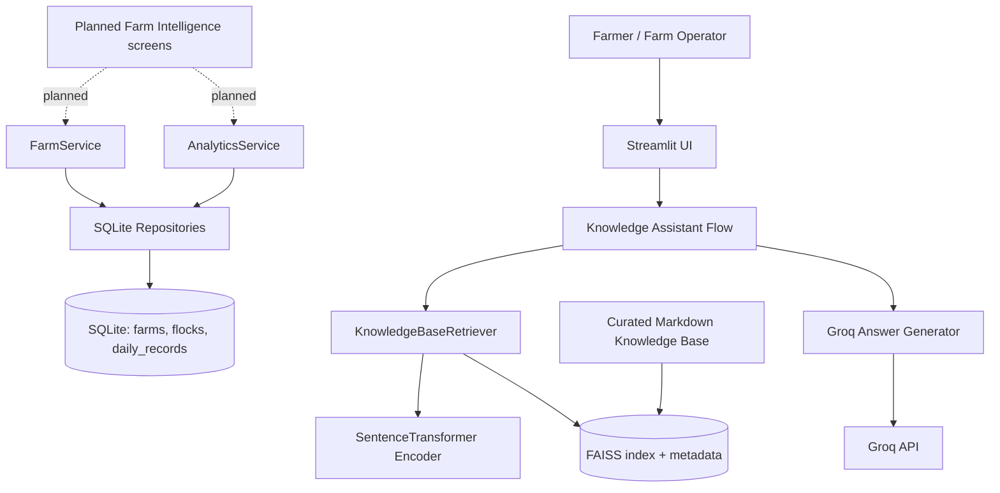

# PoultryGuard AI

**AI-assisted poultry farm management and knowledge intelligence for smallholder farmers.**

PoultryGuard AI is a developing poultry farm intelligence platform designed to help poultry farmers organise farm information and make more informed day-to-day management decisions. It is being developed with smallholder and underserved poultry operations in Northern Nigeria as an initial context.

The current codebase combines a source-grounded poultry knowledge assistant with the first farm-data foundation: farms, flocks, daily production records and flock-level analytics. The immediate engineering priority is to connect those existing services to a usable Farm Intelligence dashboard.

> **Status — 13 November 2026:** Working prototype. The Streamlit knowledge assistant, local retrieval components, Groq-based answer generation, SQLite data layer, farm/flock/daily-record services and analytics service are present in the active development branch. The Farm Intelligence user interface is not yet integrated. Formal farmer and veterinary validation has not yet been completed.

## Product direction

PoultryGuard is intended to become a practical digital workspace for poultry farm records, performance visibility and responsible, evidence-informed knowledge support.

### Current implementation

- **Poultry knowledge assistant:** Streamlit question-and-answer interface using retrieved knowledge-base passages.
- **Knowledge retrieval:** Markdown parsing/chunking, locally generated sentence-transformer embeddings and FAISS similarity search.
- **Answer generation:** Groq API through the `groq` Python client. This requires internet access and a valid API key.
- **Source visibility:** The interface displays retrieved source files and sections. Similarity is a retrieval signal, not a measure of factual correctness.
- **Farm data foundation:** SQLite tables for farms, flocks and daily flock records.
- **Application services:** `FarmService` supports farm, flock and daily-record operations. `AnalyticsService` calculates flock summaries and daily metrics.
- **Automated checks:** pytest suite, Ruff checks and knowledge-base validation scripts.

### Planned product capabilities

These are roadmap items, not claims about features already available in the user interface:

- Farm profile and multi-flock management workflows.
- Daily entry forms and an analytics dashboard for flock size, mortality, feed, water, weight and environmental readings.
- Health, vaccination, treatment, biosecurity and task records.
- Farm-specific AI summaries grounded in a farm's own recorded data and reviewed knowledge sources.
- Expert consultation workflows and farmer-facing localisation, including Hausa.
- Environmental sensors and predictive risk indicators only after data quality, domain review and field validation are established.

PoultryGuard is not a veterinary diagnostic system. Its AI features are intended to support—not replace—qualified veterinary and extension professionals. It must not prescribe medication or dosages without validated professional protocols.

## Current architecture

The active architecture is a single-process Streamlit application with separate service, repository, database and RAG concerns.



### Layer responsibilities

| Layer | Current location | Responsibility |
|---|---|---|
| Presentation | `app/frontend/main.py` | Current Streamlit knowledge-assistant UI |
| Application services | `app/services/` | Farm operations, analytics and answer generation |
| Data access | `app/database/repositories.py` | Parameterised SQLite queries |
| Persistence | `app/database/connection.py` | SQLite connection and initial schema |
| Data models | `app/database/models.py` | Farm, Flock and DailyRecord dataclasses |
| Retrieval | `rag/chunking/`, `rag/embeddings/`, `rag/indexing/`, `rag/retrieval/` | Parse, chunk, embed, index and retrieve knowledge |
| Knowledge content | `knowledge_base/` | Curated poultry Markdown content with metadata and sources |
| Runtime artefacts | `vector_store/`, `data/` | Generated FAISS index and local SQLite database; do not commit runtime data |
| Quality | `tests/`, `scripts/`, `.github/workflows/` | Unit tests, content validation, linting and CI |

The current farm data schema contains:

| Table | Purpose |
|---|---|
| `farms` | Farm identity, farmer contact and production context |
| `flocks` | Flock identity, species, production type, initial count and stocking date |
| `daily_records` | Dated feed, water, mortality, average weight, temperature, humidity and notes |

The SQLite schema is an initial local-development foundation. Before production multi-user deployment, we will introduce a migration strategy, a database abstraction suitable for PostgreSQL, authentication and access controls.

## Technology stack

| Area | Current implementation |
|---|---|
| Language | Python 3.11 |
| UI | Streamlit |
| Local persistence | SQLite |
| Database access | Python `sqlite3`, repositories and dataclasses |
| Embeddings | Sentence Transformers: `all-MiniLM-L6-v2` |
| Vector search | FAISS CPU |
| Answer generation | Groq API via `groq` |
| Knowledge content | Markdown |
| Configuration | Environment variables and `python-dotenv` |
| Tests | pytest |
| Lint and formatting | Ruff |
| CI | GitHub Actions |

**Connectivity clarification:** knowledge files, embeddings, FAISS retrieval and SQLite storage are local components. Answer generation currently calls the Groq API, so the current assistant is not fully offline. A fully local LLM is a separate future option and is not the current runtime.

## Repository structure

```text
poultryguard-ai/
├── app/
│   ├── backend/                 # Backend scaffold; not current UI entry point
│   ├── database/                # SQLite connection, dataclasses and repositories
│   ├── frontend/
│   │   └── main.py              # Current Streamlit entry point
│   └── services/
│       ├── answer_generator.py  # Groq-backed grounded response generation
│       ├── farm_service.py      # Farm, flock and daily-record use cases
│       └── analytics_service.py # Flock summary and daily metrics
├── knowledge_base/              # Curated poultry Markdown content
├── rag/
│   ├── chunking/                # Markdown parsing and chunking
│   ├── embeddings/              # Sentence Transformer encoder
│   ├── indexing/                # FAISS index builder
│   └── retrieval/               # Similarity retrieval
├── vector_store/                 # Generated FAISS index and metadata (ignored)
├── data/                         # Local SQLite database (ignored)
├── tests/                        # Unit and project tests
├── scripts/                      # Validation and developer utilities
├── docs/                         # Architecture and project documentation
├── .github/workflows/            # Continuous integration
├── requirements.txt
├── requirements-dev.txt
├── pyproject.toml
└── README.md
```

## Getting started

### 1. Clone the repository

```powershell
git clone https://github.com/zulyadainimuhammad/poultryguard-ai.git
cd poultryguard-ai
git switch feature/gta-mvp
```

The farm-data implementation and current active development work are on `feature/gta-mvp`. The repository's GitHub default branch is `main`; do not assume it contains every active-branch change until those changes are merged.

### 2. Create a Python 3.11 environment (Windows PowerShell)

```powershell
py -3.11 -m venv .venv
.\.venv\Scripts\Activate.ps1
python -m pip install --upgrade pip
pip install -r requirements-dev.txt
```

### 3. Configure answer generation

Create a local `.env` file:

```powershell
Copy-Item .env.example .env
```

Set these values in `.env`:

```dotenv
GROQ_API_KEY=your_groq_api_key
GROQ_MODEL=openai/gpt-oss-120b
```

Keep real credentials in `.env` only. Never commit API keys.

### 4. Build the local knowledge index

The retriever expects these generated files:

- `vector_store/poultryguard.faiss`
- `vector_store/metadata.json`

The index builder is implemented in `rag/indexing/indexer.py`, with a command-line wrapper at `scripts/build_index.py`. The embedding model must be available in the local Sentence Transformers cache because the encoder is configured for local-only model loading. On a connected development machine, populate the cache once with:

```powershell
python -c "from sentence_transformers import SentenceTransformer; SentenceTransformer('sentence-transformers/all-MiniLM-L6-v2')"
```

Then build the index:

```powershell
python scripts/build_index.py
```

### 5. Run the current Streamlit interface

```powershell
streamlit run app/frontend/main.py
```

The current interface exposes the poultry knowledge assistant. Farm and analytics services are present but are not yet connected to Farm Intelligence screens.

### 6. Run checks

```powershell
python -m pytest -v
ruff check .
ruff format --check .
python scripts/validate_knowledge_base.py
python scripts/validate_metadata.py
python scripts/validate_references.py
python scripts/validate_links.py
make check
```

These are development checks, not evidence of farmer field validation.

## Development phases

| Phase | Focus | Status |
|---|---|---|
| 0 | Repository and engineering foundation | In place; ongoing maintenance |
| 1 | Poultry knowledge base and content quality | Implemented foundation; domain-expert validation pending |
| 2 | RAG retrieval and AI knowledge assistant | Working prototype |
| 3 | Farm data foundation: farms, flocks, daily records and analytics services | Implemented at service/data layer |
| 4 | Farm Intelligence UI: profiles, flock workflows, records and charts | **Next implementation phase** |
| 5 | Health, vaccination, treatments, biosecurity and task records | Planned |
| 6 | Farm-aware AI summaries and expert review workflows | Planned |
| 7 | Farmer pilot, usability, veterinary/extension review and impact measurement | Not yet completed |
| 8 | Production engineering: API boundary, PostgreSQL, authentication, backups, Docker, CI/CD and deployment | Planned |
| 9 | Environmental data integrations and validated predictive intelligence | Longer-term research and validation |

Phases are capability milestones, not fixed dates. See [ROADMAP.md](ROADMAP.md) and [docs/project_plan.md](docs/project_plan.md).

## Responsible use and current limitations

- The knowledge assistant can return incomplete or incorrect answers. Verify consequential decisions with qualified professionals.
- Similarity scores indicate retrieval relevance; they do not establish factual accuracy.
- No formal farmer pilot or veterinary/extension validation is claimed at this stage.
- The current data model supports farm, flock and daily production records only; health, vaccination, treatment and task modules are future work.
- No disease-prediction performance, mortality reduction or commercial impact has been established.
- Do not enter sensitive personal, financial or identifiable farm information into an untrusted deployment.
- Farm records and AI-generated summaries must not replace veterinary diagnosis or prescription.

## Contributing

The project is currently maintained by its repository owner. Contributions should use focused branches and pull requests, with tests, documentation and source attribution where relevant. See [CONTRIBUTING.md](CONTRIBUTING.md).

## Licence

MIT. See [LICENSE](LICENSE).
