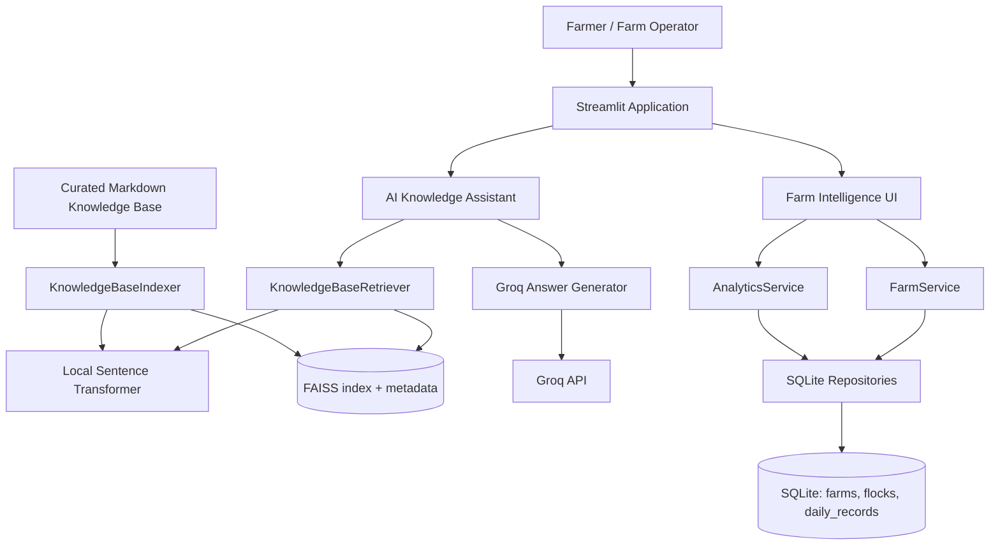

# PoultryGuard AI

**AI-assisted poultry farm management and knowledge intelligence for smallholder farmers.**

PoultryGuard AI is a developing poultry farm intelligence platform designed to help poultry farmers organise farm information, monitor flock performance and access evidence-informed poultry knowledge. Northern Nigeria is the initial product context.

> **Status — 18 November 2026:** Working local MVP. The Streamlit application now includes the Poultry Knowledge Assistant and Farm Intelligence workflows for farm profiles, flock management, daily production records and flock-level analytics. The local test suite reports 98 passing tests, and the PR #11 CI pipeline passed. Formal farmer and veterinary/extension validation has not yet been completed. The application is not yet a production multi-user cloud service.

## Product direction

The long-term goal is a cloud-enabled poultry farm intelligence platform connecting knowledge support, farm and flock records, environmental data, useful insights, alerts and qualified expert support.

The intended product structure is:

1. **AI Knowledge Assistant** — retrieves poultry knowledge and generates source-grounded answers.
2. **Farm and Flock Records** — manages farm profiles, flocks and daily production records.
3. **Farm Analytics** — presents flock population, mortality, feed, water, weight and recorded environmental measurements.
4. **Farm Monitoring and Environmental Data** — planned expansion for more complete environmental monitoring and validated sensor integrations.
5. **AI Farm Intelligence** — planned decision-support layer for insights and alerts based on farm records and environmental information.
6. **Expert Support** — planned workflow to connect farmers with veterinary and agricultural professionals.
7. **Cloud Engineering** — planned cross-cutting infrastructure for secure hosting, APIs, databases, storage, identity, monitoring, backups and delivery automation.

See [the target architecture](docs/architecture/target_architecture.md) and [ROADMAP.md](ROADMAP.md).

## Current implementation

### Available in the local application

- **Poultry Knowledge Assistant:** Streamlit question-and-answer interface using retrieved knowledge-base passages.
- **Knowledge retrieval:** Markdown parsing/chunking, locally generated Sentence Transformer embeddings and FAISS similarity search.
- **Answer generation:** Groq API through the `groq` Python client. This requires internet access and a valid API key.
- **Source visibility:** The interface displays retrieved source files and sections. Similarity is a retrieval signal, not a measure of factual correctness.
- **Farm profiles:** Register, list and select farm profiles.
- **Flock management:** Register and manage flocks linked to a selected farm.
- **Daily records:** Record date, mortality, feed, water, average bird weight, temperature, humidity and notes.
- **Flock analytics:** Display current population, mortality rate, production summaries, chronological charts and a daily metrics table.
- **Local persistence:** Farm, flock and daily-record data are stored in SQLite and persist when Streamlit restarts.
- **Quality checks:** pytest, Ruff and knowledge-base validation scripts run locally and in GitHub Actions.

### Current limitations

- Environmental readings are currently entered through daily records. Automated sensor ingestion and continuous monitoring are not implemented.
- AI-generated farm insights, automated alerts and predictive risk models are not implemented.
- Veterinary/expert referral and consultation workflows are not implemented.
- Health observations, vaccination, treatment, biosecurity and task-management records are not yet part of the current database schema.
- The application uses local SQLite and does not yet provide production authentication, multi-user authorisation, farm-level access controls or cloud deployment.
- Formal farmer pilot, usability validation and veterinary/extension review have not yet been completed.

PoultryGuard is not a veterinary diagnostic system. Its AI features are intended to support—not replace—qualified veterinary and extension professionals. It must not prescribe medication or dosages without validated professional protocols.

## Current architecture

The currently implemented application is a Streamlit interface backed by application services, SQLite repositories and a separate retrieval-augmented knowledge assistant.



The intended future architecture adds farm monitoring/environmental data, an AI Farm Intelligence decision-support layer, expert support and a cross-cutting Cloud Engineering plane. These future components are documented separately and are not represented as implemented runtime services. See [target_architecture.md](docs/architecture/target_architecture.md).

### Implemented layer responsibilities

| Layer | Current location | Responsibility |
|---|---|---|
| Presentation | `app/frontend/main.py` | Streamlit Knowledge Assistant and Farm Intelligence workflows |
| Application services | `app/services/` | Farm operations, analytics and answer generation |
| Data access | `app/database/repositories.py` | Parameterised SQLite queries |
| Persistence | `app/database/connection.py` | SQLite connection and initial schema |
| Data models | `app/database/models.py` | Farm, Flock and DailyRecord dataclasses |
| Retrieval | `rag/chunking/`, `rag/embeddings/`, `rag/indexing/`, `rag/retrieval/` | Parse, chunk, embed, index and retrieve knowledge |
| Knowledge content | `knowledge_base/` | Curated poultry Markdown content with metadata and sources |
| Runtime artefacts | `vector_store/`, `data/` | Generated FAISS index and local SQLite database; do not commit runtime data |
| Quality | `tests/`, `scripts/`, `.github/workflows/` | Unit tests, content validation, linting and CI |

The current farm data schema contains:

| Table | Purpose |
|---|---|
| `farms` | Farm identity, farmer contact and production context |
| `flocks` | Flock identity, species, production type, initial count and stocking date |
| `daily_records` | Dated feed, water, mortality, average weight, temperature, humidity and notes |

The schema is a local-development foundation. Before production multi-user deployment, the project will need a migration strategy, a production database such as PostgreSQL, authentication, authorisation and farm-level data isolation.

## Technology stack

| Area | Current implementation |
|---|---|
| Language | Python 3.11 |
| UI | Streamlit |
| Charts | Altair |
| Local persistence | SQLite |
| Database access | Python `sqlite3`, repositories and dataclasses |
| Embeddings | Sentence Transformers: `all-MiniLM-L6-v2` |
| Vector search | FAISS CPU |
| Answer generation | Groq API via `groq` |
| Knowledge content | Markdown |
| Configuration | Environment variables and `python-dotenv` |
| Tests | pytest |
| Lint and formatting | Ruff |
| CI | GitHub Actions |

**Connectivity clarification:** knowledge files, embeddings, FAISS retrieval and SQLite storage are local components. Answer generation currently calls the Groq API, so the Knowledge Assistant is not fully offline.

## Repository structure

```text
poultryguard-ai/
├── app/
│   ├── backend/                 # Backend scaffold; not current UI entry point
│   ├── database/                # SQLite connection, models and repositories
│   ├── frontend/
│   │   └── main.py              # Streamlit application entry point
│   └── services/                # Farm, analytics and answer-generation services
├── knowledge_base/              # Curated poultry Markdown content
├── rag/                          # Chunking, embeddings, indexing and retrieval
├── vector_store/                 # Generated FAISS index and metadata (ignored)
├── data/                         # Local SQLite database (ignored)
├── tests/                        # Unit and project tests
├── scripts/                      # Validation and developer utilities
├── docs/
│   ├── architecture/             # Current and target architecture documentation
│   └── project_plan.md
├── .github/workflows/            # Continuous integration
├── requirements.txt
├── requirements-dev.txt
├── pyproject.toml
└── README.md
```

## Getting started

### 1. Clone the repository

Use the default `main` branch for the current merged MVP:

```powershell
git clone https://github.com/zulyadainimuhammad/poultryguard-ai.git
cd poultryguard-ai
git switch main
```

### 2. Create a Python 3.11 environment (Windows PowerShell)

```powershell
py -3.11 -m venv .venv
.\.venv\Scripts\Activate.ps1
python -m pip install --upgrade pip
pip install -r requirements-dev.txt
```

### 3. Configure answer generation

Create a local `.env` file:

```powershell
Copy-Item .env.example .env
```

Set these values in `.env`:

```dotenv
GROQ_API_KEY=your_groq_api_key
GROQ_MODEL=qwen/qwen3.8-27b
```

Keep real credentials in `.env` only. Never commit API keys.

### 4. Build the local knowledge index

The retriever expects these generated files:

- `vector_store/poultryguard.faiss`
- `vector_store/metadata.json`

The embedding model must be available in the local Sentence Transformers cache because the encoder is configured for local-only model loading. On a connected development machine, populate the cache once with:

```powershell
python -c "from sentence_transformers import SentenceTransformer; SentenceTransformer('sentence-transformers/all-MiniLM-L6-v2')"
```

Then build the index:

```powershell
python scripts/build_index.py
```

### 5. Run PoultryGuard AI

```powershell
streamlit run app/frontend/main.py
```

The application provides two navigation areas: **Knowledge Assistant** and **Farm Intelligence**. Farm Intelligence includes Dashboard, Farm Profiles, Flock Management, Daily Records and Analytics.

### 6. Run checks

```powershell
python -m pytest
ruff check .
ruff format --check .
python scripts/validate_knowledge_base.py
python scripts/validate_metadata.py
python scripts/validate_references.py
python scripts/validate_links.py
```

The 18 November 2026 local test run reported 98 passing tests. CI for the Farm Intelligence MVP pull request also passed. These checks do not substitute for field validation.

## Development roadmap

| Stage | Focus | Status |
|---|---|---|
| 0 | Repository and engineering foundation | In place; maintain |
| 1 | Knowledge base, RAG assistant and Farm Intelligence MVP | Implemented working prototype |
| 2 | Farm Monitoring and Environmental Intelligence | Next |
| 3 | AI Farm Intelligence insights and alerts | Planned |
| 4 | Veterinary and expert support workflows | Planned |
| 5 | Cloud Engineering and production deployment | Planned |
| 6 | Farmer pilot, professional validation and localisation | Not yet completed |
| 7 | Sensor integrations and predictive intelligence | Longer-term; dependent on reliable data and validation |

See [ROADMAP.md](ROADMAP.md), [the implementation plan](docs/project_plan.md) and [the architecture documentation](docs/architecture/README.md).

## Responsible use and current limitations

- The Knowledge Assistant can return incomplete or incorrect answers. Verify consequential decisions with qualified professionals.
- Similarity scores indicate retrieval relevance; they do not establish factual accuracy.
- No formal farmer pilot or veterinary/extension validation is claimed.
- No disease-prediction performance, mortality reduction or commercial impact has been established.
- Do not enter sensitive personal, financial or identifiable farm information into an untrusted deployment.
- Farm records and AI-generated summaries must not replace veterinary diagnosis or prescription.

## Contributing

The project is maintained through focused branches and pull requests. Contributions should include relevant tests, documentation and source attribution. See [CONTRIBUTING.md](CONTRIBUTING.md).

## Licence

MIT. See [LICENSE](LICENSE).
