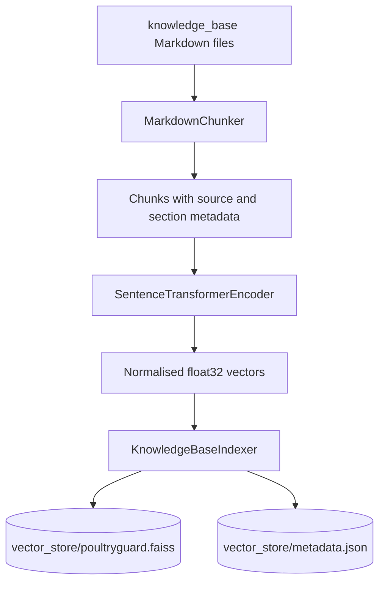
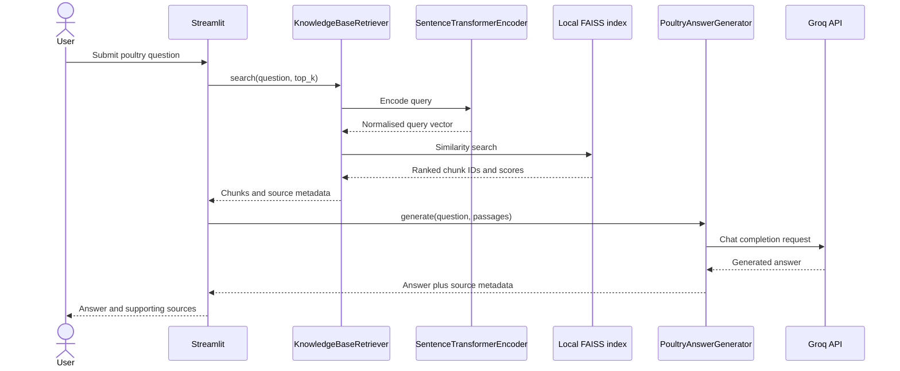
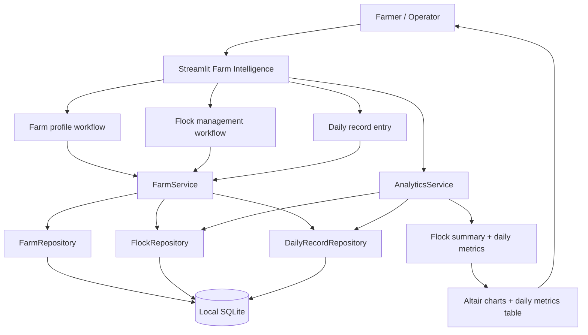

# Data Flow

**Last reviewed:** 18 November 2026

This document records the implemented knowledge-indexing, question-answering and Farm Intelligence data paths. It distinguishes local processing from the external answer-generation request and identifies future flows that are not yet implemented.

## 1. Knowledge indexing

The indexer is implemented in `rag/indexing/indexer.py`. It discovers Markdown documents, excludes README files, chunks documents, generates embeddings, creates a FAISS `IndexFlatIP` index and saves aligned metadata.

The embedding model is loaded with local-only loading; it must already exist in the local cache. The generated FAISS index and JSON metadata are runtime artefacts and should not be committed.

## 2. Knowledge question answering

The current generator requires `GROQ_API_KEY` and network access. Retrieval score is similarity, not evidence quality or truth probability. The answer generator is instructed to communicate insufficient evidence rather than invent facts.

## 3. Farm Intelligence workflow

Current user flow:
1. The operator selects a farm.
2. The operator creates or selects a flock belonging to that farm.
3. The operator enters a dated daily record.
4. `FarmService` validates the input and coordinates repository writes.
5. The selected flock's summary and daily metrics are computed through `AnalyticsService`.
6. The UI renders summary values, charts and the full daily metrics table.

The current schema stores:
- Farm profile and contact/context fields.
- Flock identity, species, production type, initial population, stocking date and status.
- Daily feed, water, mortality, average weight, temperature, humidity and notes.

The current local workflow persists records in SQLite. Manual restart checks confirmed that sample farm, flock and daily-record data remained available after Streamlit restarted.

## 4. Analytics semantics and data quality

- Daily records are displayed and analysed in chronological order.
- Cumulative mortality is a running total ordered by record date.
- Current flock population is based on initial population less recorded mortality.
- Feed, water, weight and environmental summaries use recorded values.
- Missing measurements remain missing; a valid numeric zero is not treated as missing.
- Suspicious weight entries are flagged for user review rather than silently changed.
- Charts show explicit point markers so a single real observation is visible; no synthetic observations are inserted.

Data correction and duplicate-entry policy should remain explicit. Before multi-user production use, record provenance, edit history and access control require further design.

## 5. Local data at rest

| Data | Location | Format | Git-tracked |
|---|---|---|---|
| Poultry knowledge | `knowledge_base/` | Markdown | Yes |
| Farm data | `data/poultryguard.db` | SQLite | No |
| Vector index | `vector_store/poultryguard.faiss` | FAISS binary | No |
| Chunk metadata | `vector_store/metadata.json` | JSON | No |
| Embedding model cache | Local Sentence Transformers cache | Model files | No |
| API credentials | Local `.env` | Environment values | No |

Do not store private farmer data in the repository or issue tracker. Production privacy, retention, identity and access-control policies must be defined before a hosted pilot.

## 6. Planned data flows

The following are target capabilities, not implemented flows:

- **Environmental telemetry:** sensors/devices → secure ingestion → validation and provenance → time-series storage → monitoring views.
- **Insights and alerts:** validated farm data + reviewed rules → explainable observation → alert lifecycle → farmer acknowledgement or expert escalation.
- **Expert support:** farmer consent → scoped record sharing → verified professional review → attributed response and audit history.
- **Cloud operations:** authenticated API → application services → managed database/storage → observability, backups and recovery.

Health events, vaccination, treatment history, biosecurity, tasks, expert consultations, sensor streams and farm-aware AI summaries require explicit data definitions, access controls, validation and tests before implementation. See [Target Architecture](target_architecture.md).
