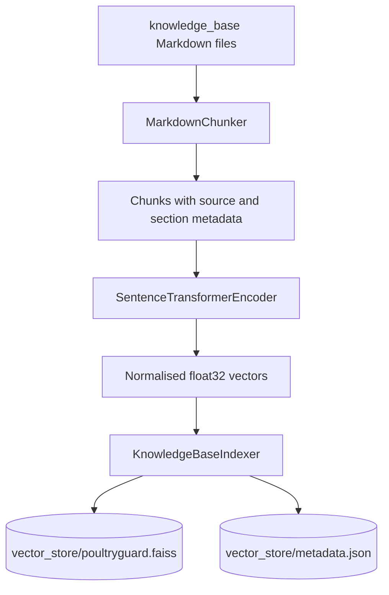
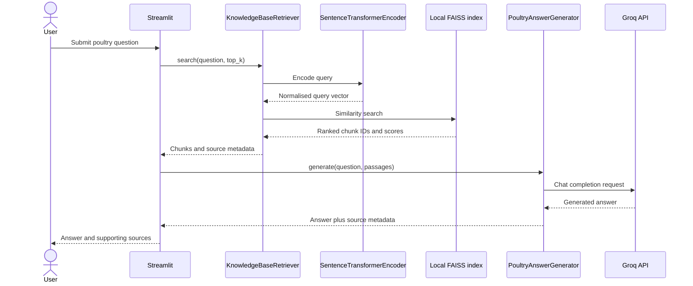
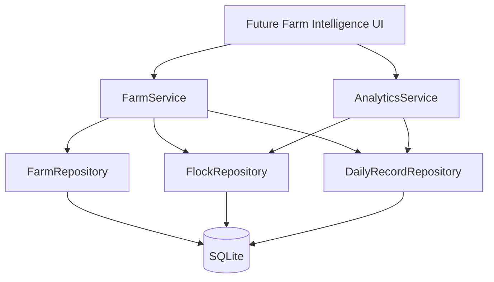

# Data Flow

**Last reviewed:** 13 November 2026

This document records the two implemented data paths in the current prototype: knowledge indexing/retrieval and farm record persistence/analytics. It distinguishes local processing from the external answer-generation request.

## 1. Knowledge indexing

The implemented indexer is `rag/indexing/indexer.py`. It discovers Markdown documents, excludes README files, chunks the documents, generates embeddings, creates a FAISS `IndexFlatIP` index and saves matching metadata.

The embedding model is loaded with `local_files_only=True`; the model must already exist in the local cache. The generated FAISS index and JSON metadata are runtime artefacts and should not be committed.

## 2. Knowledge question answering

The current generator requires `GROQ_API_KEY` and network access. Retrieval score is similarity, not evidence quality or truth probability. If evidence is insufficient, the generator is instructed to say so rather than invent facts.

## 3. Farm record workflow

The service and repository layers exist, but Farm Intelligence UI screens are still to be built. The current schema stores:

- Farm profile and contact/context fields.
- Flock identity and initial population.
- Daily feed, water, mortality, weight and environmental readings.

Analytics should use chronological record order for cumulative metrics. Missing measurements should remain missing rather than being silently interpreted as zero.

## 4. Local data at rest

| Data | Location | Format | Git-tracked |
|---|---|---|---|
| Poultry knowledge | `knowledge_base/` | Markdown | Yes |
| Farm data | `data/poultryguard.db` | SQLite | No |
| Vector index | `vector_store/poultryguard.faiss` | FAISS binary | No |
| Chunk metadata | `vector_store/metadata.json` | JSON | No |
| Embedding model cache | Local Sentence Transformers cache | Model files | No |
| API credentials | Local `.env` | Environment values | No |

Do not store private farmer data in the repository or issue tracker. Production privacy, retention and access-control policies must be defined before a hosted pilot.

## 5. Future data flows

Health events, vaccination records, treatment history, task reminders, expert consultation, environmental sensor streams and farm-aware AI summaries are planned, not implemented. Each requires explicit data definitions, access controls, validation and tests before inclusion.
