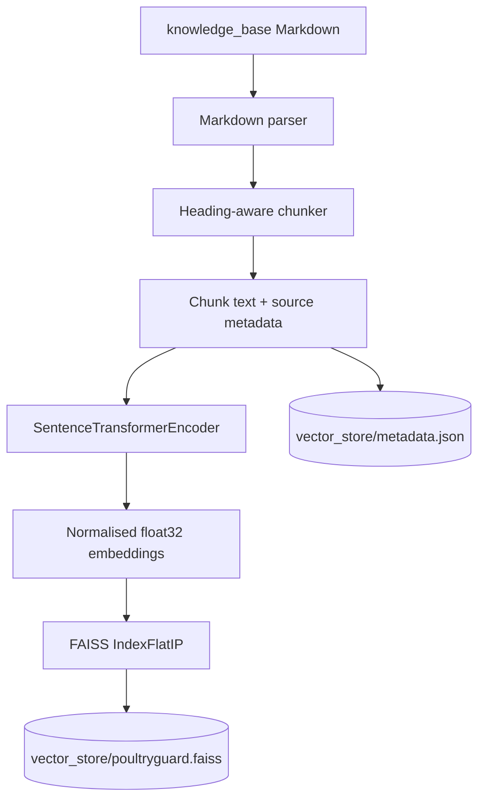
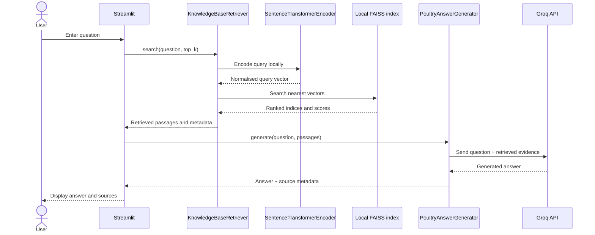

# Retrieval-Augmented Generation Design

**Last reviewed:** 13 November 2026

This document describes the RAG pipeline currently implemented in PoultryGuard AI.

## 1. Implemented components

| Responsibility | Module |
|---|---|
| Parse Markdown and metadata | `rag/chunking/markdown_parser.py` |
| Split documents into retrieval chunks | `rag/chunking/chunker.py` |
| Chunk metadata and IDs | `rag/chunking/metadata.py` |
| Generate embeddings | `rag/embeddings/encoder.py` |
| Build FAISS index and metadata | `rag/indexing/indexer.py` |
| Command-line index build | `scripts/build_index.py` |
| Semantic retrieval | `rag/retrieval/retriever.py` |
| Generate final answer | `app/services/answer_generator.py` |

There is no separate active prompt-builder module in the query path; the current answer generator constructs the system and user messages directly.

## 2. Indexing flow



The indexer:
- Recursively discovers Markdown files under the knowledge-base directory.
- Excludes README files.
- Parses front matter and H2 sections.
- Chunks long sections using configured windows/overlap.
- Embeds chunks with `sentence-transformers/all-MiniLM-L6-v2`.
- Builds a FAISS `IndexFlatIP` index over normalised vectors.
- Saves the index and aligned chunk records.

Run the build from the repository root:

```powershell
python scripts/build_index.py
```

The embedding model is loaded with `local_files_only=True`. Cache the model on a connected machine before running the builder.

## 3. Query flow



Retrieval is local. Answer generation uses Groq and requires network connectivity and an API key.

## 4. Metadata and traceability

Each retrieved record includes the text and fields such as source file, section and domain. The UI displays source file and section. The similarity score is included when available and is labelled as a retrieval similarity signal.

The system should preserve the distinction between:
- Source document content.
- Retrieved passage metadata.
- Similarity ranking score.
- Provider-generated response text.

## 5. Current limitations and next quality work

- The retriever validates that index and metadata record counts match, but retrieval relevance still requires a curated evaluation set.
- The current search path does not establish a validated factual confidence threshold.
- The model cache must be prepared separately; runtime embedding is local-only.
- The answer generation step depends on an external provider.
- Safety regression tests and expert review are required for disease, vaccination and treatment topics.
- Farm-record context is not yet included in the knowledge-assistant prompt.

Do not describe this pipeline as fully offline, medically diagnostic or validated for disease prediction.
