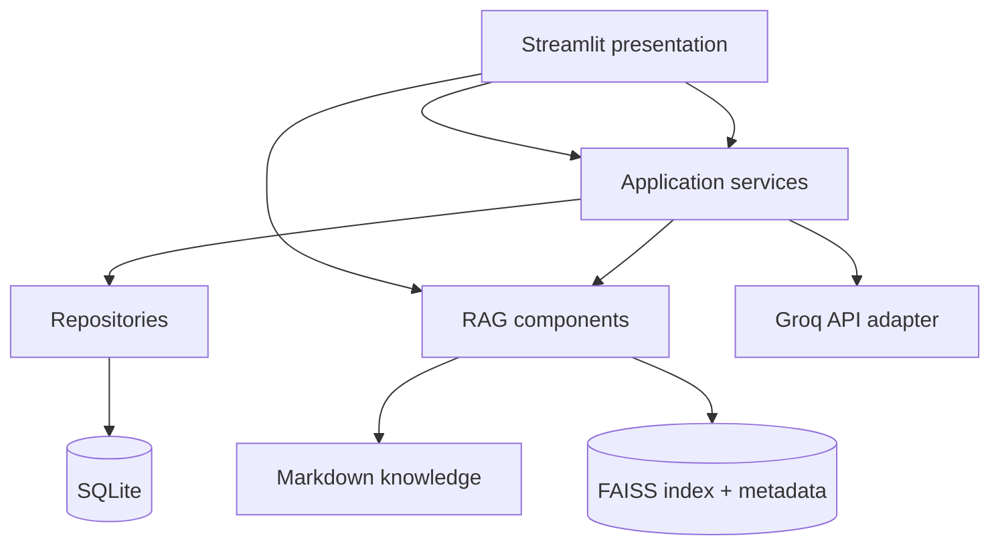

# Software Architecture

**Last reviewed:** 13 November 2026  
**Status:** Describes the active prototype, not the earlier proposed ADTC architecture.

## 1. Architectural style

PoultryGuard AI currently uses a modular, single-process Streamlit application. The code separates presentation, application services, repository-based data access, local persistence and the RAG subsystem. This keeps core operations testable and provides a path to introduce an API boundary and managed database later without prematurely adding distributed infrastructure.

## 2. Current module map

```text
poultryguard-ai/
├── app/
│   ├── database/
│   │   ├── connection.py       # SQLite connection and initial schema
│   │   ├── models.py           # Farm, Flock, DailyRecord dataclasses
│   │   └── repositories.py     # SQL persistence operations
│   ├── frontend/
│   │   └── main.py             # Current Streamlit entry point
│   └── services/
│       ├── answer_generator.py # Groq-backed answer generation
│       ├── farm_service.py     # Farm, flock and daily-record use cases
│       └── analytics_service.py
├── knowledge_base/              # Curated source documents
├── rag/
│   ├── chunking/               # Markdown parser and chunker
│   ├── embeddings/             # Sentence Transformer encoder
│   ├── indexing/               # FAISS index builder
│   └── retrieval/              # Semantic retriever
├── vector_store/                # Generated index and metadata (ignored)
├── data/                        # SQLite database (ignored)
├── tests/
├── scripts/
└── docs/
```

## 3. Dependency direction



Rules:

1. UI code calls service methods and renders results; it must not contain SQL statements.
2. Application services own use-case coordination and validation that spans repositories.
3. Repositories own SQL and map database rows to plain Python dictionaries.
4. RAG modules must not import Streamlit.
5. The answer-generation provider is isolated in a service so it can be replaced or supplemented later.
6. External services and secrets are configured outside source code.

## 4. Farm workflow

The intended user journey is:

```text
Create farm
    ↓
Create flock for the farm
    ↓
Record daily flock observations
    ↓
Retrieve records and calculate metrics
    ↓
Display farm/flock dashboard
```

The first three data operations and analytics service exist. The Streamlit workflow and dashboard do not yet exist.

### Persistence entities

| Entity/table | Key relationship | Current fields |
|---|---|---|
| Farm / `farms` | Parent of flocks | Farm name, farmer, location, phone, email, production type |
| Flock / `flocks` | Belongs to farm | Name, species, production type, breed, initial count, stocking date, status |
| DailyRecord / `daily_records` | Belongs to flock | Record date, feed, water, mortality, average weight, temperature, humidity, notes |

The current database schema is initialised through `initialise_database()`. The application startup should invoke this before farm workflows are exposed. Add a migration framework before extending the schema with new entities.

## 5. Knowledge assistant workflow

1. User submits a question in Streamlit.
2. `KnowledgeBaseRetriever` loads the persisted FAISS index and metadata.
3. The encoder transforms the query into a normalised embedding.
4. FAISS returns the nearest chunks and associated source metadata.
5. `PoultryAnswerGenerator` sends the question and retrieved passages to Groq.
6. The UI displays the generated answer and supporting source passages.

The embedding and retrieval work is local. The current generation request is sent to the Groq API. This is not a zero-network/offline runtime.

## 6. Data and service design

- Use dependency injection in service constructors so repositories can be replaced by fakes in unit tests.
- Keep repository methods parameterised; never interpolate user input into SQL.
- Validate numerical inputs at service/repository boundaries.
- Ensure time-series metrics use chronological ordering before cumulative calculations.
- Define duplicate daily-record and correction semantics before the dashboard enables editing.
- Never treat missing observations as zero unless the metric definition explicitly requires it.

## 7. Future production boundary

Do not add cloud services merely to make the architecture look distributed. When multi-user access, remote synchronisation or reliable hosted operation becomes necessary:

- Introduce a documented API contract between UI and services.
- Add authentication, authorisation and farm-level data isolation.
- Add schema migrations and PostgreSQL as the production datastore.
- Keep SQLite useful for local development and tests.
- Add Docker, CI/CD, backups, observability and deployment controls with measurable operational requirements.

## 8. Safety and auditability

PoultryGuard is a decision-support product, not a veterinary diagnostic or prescription system. AI output must distinguish recorded farm facts from retrieved general guidance, identify uncertainty and refer consequential health decisions to qualified professionals. Future health/treatment workflows require review, provenance and audit history.
