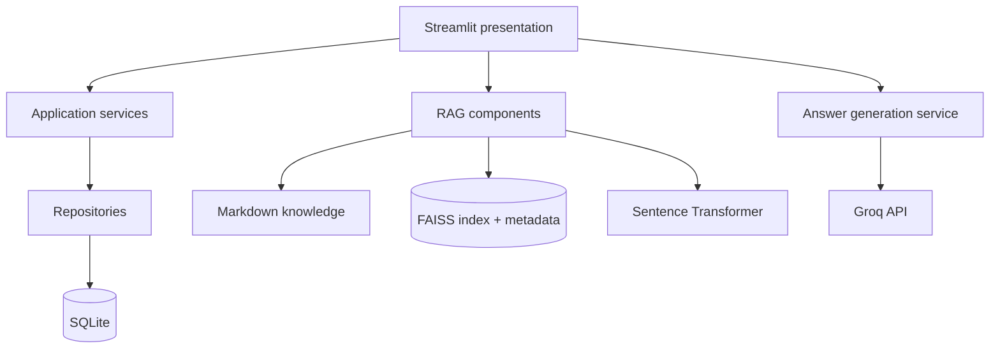

# Software Architecture

**Last reviewed:** 18 November 2026  
**Status:** Describes the merged local MVP and identifies the future production boundary.

## 1. Architectural style

PoultryGuard AI currently uses a modular, single-process Streamlit application. Presentation, application services, repository-based data access, local persistence and the RAG subsystem are separated so core operations can be tested without prematurely introducing distributed infrastructure.

The current application exposes two user areas:
- **Knowledge Assistant:** retrieval-augmented poultry knowledge support.
- **Farm Intelligence:** farm profiles, flock management, daily records and analytics.

Cloud Engineering, sensor ingestion, automated alerts and expert workflows are target capabilities, not current runtime services. See [Target Architecture](target_architecture.md).

## 2. Current module map

```text
poultryguard-ai/
├── app/
│   ├── database/
│   │   ├── connection.py       # SQLite connection and initial schema
│   │   ├── models.py           # Farm, Flock, DailyRecord dataclasses
│   │   └── repositories.py     # SQL persistence operations
│   ├── frontend/
│   │   └── main.py             # Streamlit Knowledge Assistant + Farm Intelligence
│   └── services/
│       ├── answer_generator.py # Groq-backed answer generation
│       ├── farm_service.py     # Farm, flock and daily-record use cases
│       └── analytics_service.py
├── knowledge_base/              # Curated source documents
├── rag/
│   ├── chunking/               # Markdown parser and chunker
│   ├── embeddings/             # Sentence Transformer encoder
│   ├── indexing/               # FAISS index builder
│   └── retrieval/              # Semantic retriever
├── vector_store/                # Generated index and metadata (ignored)
├── data/                        # SQLite database (ignored)
├── tests/
├── scripts/
└── docs/
```

## 3. Current dependency direction



Rules:
1. UI code calls service methods and renders results; it must not contain SQL statements.
2. Application services own use-case coordination and validation that spans repositories.
3. Repositories own SQL and map database rows to plain Python values.
4. RAG modules must not import Streamlit.
5. The answer-generation provider is isolated in a service so it can be replaced or supplemented later.
6. External services and secrets are configured outside source code.
7. Schema changes require explicit migration planning and data-preservation tests.

## 4. Farm workflow

The implemented user journey is:

```text
Create/select farm
    ↓
Create/select flock for the farm
    ↓
Record daily flock observations
    ↓
Retrieve records and calculate metrics
    ↓
Display flock analytics
```

### Persistence entities

| Entity/table | Key relationship | Current fields |
|---|---|---|
| Farm / `farms` | Parent of flocks | Farm name, farmer, location, phone, email, production type |
| Flock / `flocks` | Belongs to farm | Name, species, production type, breed, initial count, stocking date, status |
| DailyRecord / `daily_records` | Belongs to flock | Record date, feed, water, mortality, average weight, temperature, humidity, notes |

The schema is initialised through `initialise_database()`. Before adding health, vaccination, treatment, sensor or consultation entities, introduce and test a versioned migration strategy.

## 5. Analytics workflow

1. The UI asks `AnalyticsService` for a flock summary and daily metrics.
2. The service reads flock and daily-record data through repositories.
3. Repository results are ordered chronologically for time-series calculations.
4. The UI displays summary metrics, Altair charts and the full daily-metrics table.
5. Missing values remain missing; valid zero values are retained.

Charts use explicit points in addition to lines so a single observation remains visible. The remaining-population chart uses a non-negative, zero-based Y-axis. These presentation choices do not add artificial observations.

## 6. Knowledge assistant workflow

1. User submits a question in Streamlit.
2. `KnowledgeBaseRetriever` loads the persisted FAISS index and metadata.
3. The encoder transforms the query into a normalised embedding.
4. FAISS returns nearest chunks and source metadata.
5. `PoultryAnswerGenerator` sends the question and retrieved passages to Groq.
6. The UI displays the generated response and supporting source metadata.

Embedding and retrieval work is local. The current generation request is sent to the Groq API and requires network access and `GROQ_API_KEY`.

## 7. Data and service design

- Use dependency injection in service constructors so repositories can be replaced by fakes in unit tests.
- Keep repository methods parameterised; never interpolate user input into SQL.
- Validate numerical inputs and farm/flock relationships at service boundaries.
- Ensure time-series metrics use chronological ordering before cumulative calculations.
- Define duplicate daily-record and correction semantics before enabling editing.
- Never treat missing observations as zero unless the metric definition explicitly requires it.
- Do not silently change suspicious user-entered measurements; flag them for review.

## 8. Target production boundary

When multi-user access, remote synchronisation or reliable hosted operation becomes a validated requirement:

- Introduce a documented, versioned API contract between clients and application services.
- Add authentication, role-based authorisation and farm-level data isolation.
- Add schema migrations and evaluate PostgreSQL for production persistence.
- Define document/object storage for approved files and generated artefacts.
- Add secrets management, encryption, backups and tested recovery.
- Containerise the supported runtime.
- Add CI/CD, environment separation, observability, monitoring and rollback.

Cloud provider and deployment topology remain undecided until requirements and cost comparisons are documented. The cross-cutting target is detailed in [Target Architecture](target_architecture.md).

## 9. Safety and auditability

PoultryGuard is a decision-support product, not a veterinary diagnostic or prescription system. AI output must distinguish recorded farm facts from retrieved general guidance, identify uncertainty and refer consequential health decisions to qualified professionals. Future health/treatment and expert-support workflows require review, provenance, consent and audit history.
