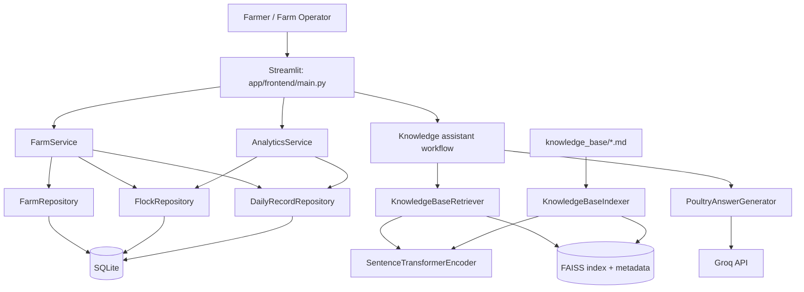

# System Overview

**Last reviewed:** 13 November 2026  
**Product state:** Working prototype

## Purpose

PoultryGuard AI is a developing poultry farm intelligence platform intended to help smallholder poultry farmers organise farm records, understand flock performance and access evidence-informed poultry knowledge. The initial product context is Northern Nigeria.

The current system has two working foundations:

1. A poultry knowledge assistant built around curated Markdown knowledge, local semantic retrieval and Groq-based answer generation.
2. A farm data layer with SQLite persistence, farm/flock/daily-record repositories, application services and flock analytics.

The Farm Intelligence screens that will expose the farm-data services to users are the next implementation phase. The project has not yet completed formal farmer or veterinary/extension validation.

## Current system architecture

## Current components

| Component | Repository path | State and responsibility |
|---|---|---|
| Streamlit interface | `app/frontend/main.py` | Current knowledge assistant interface |
| Farm service | `app/services/farm_service.py` | Creates and retrieves farms, flocks and daily records |
| Analytics service | `app/services/analytics_service.py` | Calculates flock summary and daily production metrics |
| Answer generator | `app/services/answer_generator.py` | Sends retrieved evidence to Groq and returns answer plus sources |
| Database connection | `app/database/connection.py` | Creates SQLite connections and initial schema |
| Data models | `app/database/models.py` | Farm, Flock and DailyRecord dataclasses |
| Repositories | `app/database/repositories.py` | SQLite persistence operations |
| Markdown parsing/chunking | `rag/chunking/` | Parses source metadata and splits documents into retrieval chunks |
| Embeddings | `rag/embeddings/encoder.py` | Generates local sentence-transformer embeddings |
| Indexing | `rag/indexing/indexer.py` | Builds and persists a FAISS inner-product index and chunk metadata |
| Retrieval | `rag/retrieval/retriever.py` | Loads FAISS index and searches semantically |
| Knowledge corpus | `knowledge_base/` | Poultry content with metadata and source references |

## Farm data model

The current SQLite schema contains three tables:

- `farms`: farm and farmer profile fields.
- `flocks`: flock identity, farm relationship, species, production type, breed, initial population, stocking date and status.
- `daily_records`: date, feed, water, mortality, average weight, temperature, humidity and notes.

Health observations, vaccination events, treatment events, tasks, expert consultations and sensor telemetry are not yet part of the current schema.

## Technology and connectivity

| Concern | Current choice |
|---|---|
| Runtime | Python 3.11 |
| User interface | Streamlit |
| Farm persistence | SQLite |
| Data access | `sqlite3` repositories |
| Embedding model | `sentence-transformers/all-MiniLM-L6-v2` (local inference; cache required) |
| Vector search | FAISS CPU |
| Answer generation | Groq API |
| Knowledge content | Version-controlled Markdown |
| Test framework | pytest |
| Lint and formatting | Ruff |
| CI | GitHub Actions |

**Important:** retrieval and database operations are local, but generated answers currently use the Groq API and require network connectivity and `GROQ_API_KEY`. The current runtime is therefore not an entirely offline application. llama.cpp/GGUF documents in the repository describe an earlier design direction, not the active answer-generation implementation.

## Architectural boundaries

- Streamlit pages should call application services, not execute SQL directly.
- Services coordinate use cases and depend on repositories.
- Repositories own persistence queries.
- RAG components remain independent of Streamlit.
- Generated index and database files are local runtime artefacts and must not be committed.
- New database tables should be introduced through explicit migrations once schema evolution begins.

## Product limitations

- The Farm Intelligence user interface is not yet integrated.
- No formal farmer pilot or veterinary/extension review is claimed.
- The current product does not diagnose poultry disease or prescribe medication.
- Predictive performance and impact outcomes have not been established.

## Roadmap

See [`ROADMAP.md`](../../ROADMAP.md) for product phases and [`docs/project_plan.md`](../project_plan.md) for implementation tasks.
