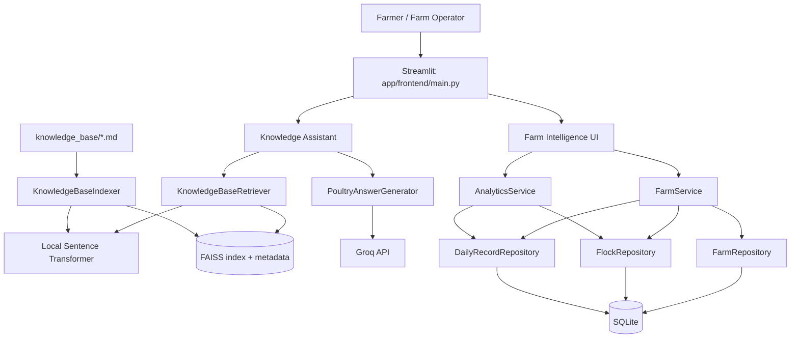

# System Overview

**Last reviewed:** 18 November 2026  
**Product state:** Local working MVP; production and field validation remain outstanding

## Purpose

PoultryGuard AI is a developing poultry farm intelligence platform intended to help poultry farmers organise farm records, understand flock performance and access evidence-informed poultry knowledge. Northern Nigeria is the initial product context.

The merged local MVP contains two working product areas:

1. A poultry Knowledge Assistant built around curated Markdown knowledge, local semantic retrieval and Groq-based answer generation.
2. Farm Intelligence workflows for farm profiles, flock management, daily production records and flock analytics, backed by SQLite and application services.

The project has passed its current automated test and CI checks, and local manual verification covered the core farm-to-analytics workflow and persistence after restarting Streamlit. Formal farmer pilot and veterinary/extension validation have not yet been completed.

## Current implemented system

## Current components

| Component | Repository path | State and responsibility |
|---|---|---|
| Streamlit interface | `app/frontend/main.py` | Knowledge Assistant and Farm Intelligence workflows |
| Farm service | `app/services/farm_service.py` | Creates, validates and retrieves farms, flocks and daily records |
| Analytics service | `app/services/analytics_service.py` | Calculates flock summaries and daily production metrics |
| Answer generator | `app/services/answer_generator.py` | Sends retrieved evidence to Groq and returns answer plus sources |
| Database connection | `app/database/connection.py` | Creates SQLite connections and initial schema |
| Data models | `app/database/models.py` | Farm, Flock and DailyRecord dataclasses |
| Repositories | `app/database/repositories.py` | SQLite persistence operations |
| Markdown parsing/chunking | `rag/chunking/` | Parses source metadata and splits documents into retrieval chunks |
| Embeddings | `rag/embeddings/encoder.py` | Generates local sentence-transformer embeddings |
| Indexing | `rag/indexing/indexer.py` | Builds and persists a FAISS inner-product index and chunk metadata |
| Retrieval | `rag/retrieval/retriever.py` | Loads FAISS index and performs semantic search |
| Knowledge corpus | `knowledge_base/` | Poultry content with metadata and source references |

## Farm data model

The current SQLite schema contains three tables:

- `farms`: farm and farmer profile fields.
- `flocks`: flock identity, farm relationship, species, production type, breed, initial population, stocking date and status.
- `daily_records`: date, feed, water, mortality, average weight, temperature, humidity and notes.

Health observations, vaccination events, treatment events, biosecurity checks, tasks, expert consultations and sensor telemetry are not yet part of the current schema.

## Technology and connectivity

| Concern | Current choice |
|---|---|
| Runtime | Python 3.11 |
| User interface | Streamlit |
| Charts | Altair |
| Farm persistence | SQLite |
| Data access | `sqlite3` repositories |
| Embedding model | `sentence-transformers/all-MiniLM-L6-v2` (local inference; cache required) |
| Vector search | FAISS CPU |
| Answer generation | Groq API |
| Knowledge content | Version-controlled Markdown |
| Tests | pytest |
| Lint and formatting | Ruff |
| CI | GitHub Actions |

**Connectivity:** retrieval and farm database operations are local. Answer generation calls the Groq API and therefore requires network access and `GROQ_API_KEY`. The current runtime is not an entirely offline application.

## Current operational boundaries

- The Streamlit UI calls application services; it should not execute SQL directly.
- Services coordinate use cases and depend on repositories.
- Repositories own persistence queries.
- RAG components remain independent of Streamlit.
- Generated index and database files are local runtime artefacts and must not be committed.
- New database tables should be introduced through explicit migrations before schema expansion.
- Local SQLite/Streamlit is a development and MVP runtime, not a production multi-user hosting design.

## Target architecture

The longer-term product architecture extends the current MVP with dedicated Farm Monitoring and Environmental Data, an AI Farm Intelligence decision-support layer, intelligent alerts, expert support and Cloud Engineering.

These are target capabilities, not current runtime components. See [Target Architecture](target_architecture.md) for the conceptual architecture, responsibilities, data boundaries and delivery sequence.

## Product limitations

- Environmental information is currently captured through manually entered daily records; automatic sensor ingestion is not implemented.
- AI-generated farm insights and alerts are not implemented.
- Veterinary/expert referral workflows are not implemented.
- Health, vaccination, treatment and task records are not yet implemented.
- No production API, authentication, multi-user authorisation, PostgreSQL deployment or cloud-hosted service is currently claimed.
- No formal farmer pilot or veterinary/extension review is claimed.
- No predictive performance, mortality reduction or commercial impact has been established.

## Roadmap

See [ROADMAP.md](../../ROADMAP.md) for product stages and [docs/project_plan.md](../project_plan.md) for implementation tasks.
