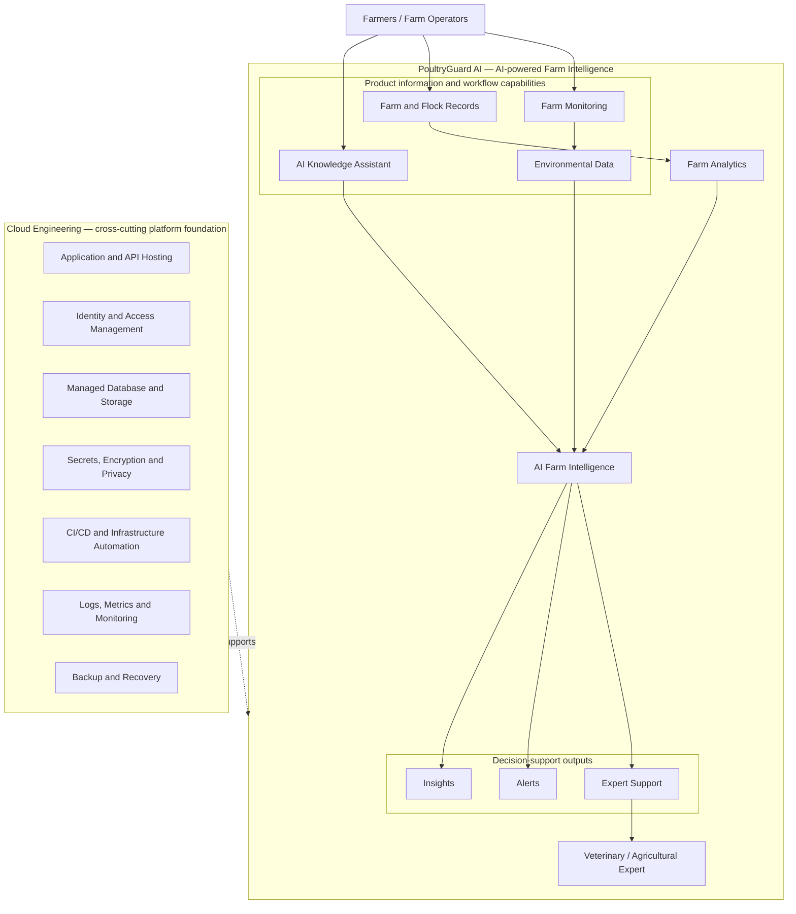

# PoultryGuard AI — Target Architecture

**Document status:** Target architecture and design direction  
**Last reviewed:** 18 November 2026  
**Current implementation baseline:** Local Streamlit MVP in `main`

## 1. Vision

PoultryGuard AI is intended to grow from the current local MVP into a cloud-enabled poultry farm intelligence platform. The platform will connect poultry knowledge, structured farm and flock records, environmental monitoring, interpretable insights, alerts and qualified professional support.

The architecture diagram shared during product planning describes the product's functional flow:

- PoultryGuard AI provides AI-powered farm intelligence.
- AI Knowledge Assistant, Farm & Flock Records and Farm Monitoring / Environmental Data provide the principal information inputs.
- Farm Analytics and environmental observations feed the AI Farm Intelligence layer.
- AI Farm Intelligence produces insights and alerts and supports expert referral.
- Veterinary and agricultural professionals remain responsible for professional assessment and advice.
- Cloud Engineering supports the platform across these capabilities.

This document distinguishes the implemented MVP from the target architecture. The target components below are design goals, not claims that their services are already implemented.

## 2. Conceptual target architecture

## 3. Current implementation versus target components

| Diagram component | Current implementation | Target evolution |
|---|---|---|
| AI Knowledge Assistant | Streamlit RAG workflow, local embeddings/FAISS, Groq answer generation and source display | Farm-aware, permission-checked context and expert-reviewed localisation |
| Farm & Flock Records | Farm profiles, flock management and daily production records in Streamlit/SQLite | Expanded operational record types, multi-user access and audit history |
| Farm Analytics | Flock summaries, mortality, population, feed, water, weight and recorded environment metrics | Longer-term trend analysis, normalised measures and data coverage indicators |
| Farm Monitoring | Manual daily records and current analytics | Dedicated monitoring workflows, data-quality handling and later telemetry |
| Environmental Data | Manually entered temperature and humidity fields | Device-agnostic, time-stamped sensor ingestion with calibration and provenance |
| AI Farm Intelligence | Not implemented as a separate insight engine | Transparent rule-based observations and, later, validated predictive decision support |
| Insights | Summary metrics and charts only | Explainable, evidence-linked, farm-contextualised insights |
| Alerts | Not implemented | Alert rules, severity, notification, acknowledgement and resolution lifecycle |
| Expert Support | Not implemented | Farmer-initiated referrals and auditable communication with qualified professionals |
| Veterinary / Agricultural Expert | No integrated workflow | Professional role verification and human-led assessment |
| Cloud Engineering | Not implemented; current runtime is local Streamlit + SQLite with Groq API access | Hosting, API, managed data services, security, deployment automation, observability and recovery |

## 4. Functional responsibilities and boundaries

### 4.1 AI Knowledge Assistant

**Purpose:** Retrieve relevant poultry knowledge and produce answers with visible source context.

Current responsibilities:
- Use curated Markdown content with source metadata.
- Retrieve passages using local Sentence Transformer embeddings and FAISS.
- Generate answers through the configured Groq chat model.
- Display supporting source metadata and communicate limitations.

Target responsibilities:
- Support reviewed Hausa/localised content.
- Distinguish general knowledge evidence from farm-specific observations.
- Enforce user and farm permissions before including records in an answer.
- Preserve source attribution and uncertainty.

The Knowledge Assistant must not present itself as a veterinary diagnostic or prescription system.

### 4.2 Farm and Flock Records

**Purpose:** Maintain the structured operational record for each farm and flock.

Current entities:
- `Farm`
- `Flock`
- `DailyRecord`

Current data includes farm identity/contact context, flock species and production context, initial population, stocking date, and dated mortality/feed/water/weight/temperature/humidity/notes.

Target extensions may include:
- Health observations.
- Vaccination events.
- Treatment records.
- Biosecurity checks.
- Tasks and reminders.
- Expert consultation records.
- Device and sensor metadata.

New entities require explicit schema migrations, validation rules, repository/service contracts, tests and documented data-retention behaviour.

### 4.3 Farm Analytics

**Purpose:** Convert stored farm and flock records into traceable descriptive metrics.

Current metrics include:
- Initial and current flock population.
- Cumulative mortality and mortality rate.
- Feed and water totals.
- Recorded average weight.
- Recorded temperature and humidity summaries.
- Daily metrics and chronological charts.

Target extensions:
- Clearly defined rates with explicit denominators and units.
- Time-window comparisons and data-coverage indicators.
- Farm-level aggregation that respects flock differences and dates.
- Data-quality flags for implausible, missing or inconsistent observations.

Analytics must not silently replace missing values with zero or alter user-recorded values.

### 4.4 Farm Monitoring and Environmental Data

**Purpose:** Provide an operational view of flock and housing conditions over time.

Initial monitoring should reuse the existing daily-record data while making measurement definitions explicit:
- Measurement name and unit.
- Observation time and time zone.
- Data source (manual entry, imported file or device).
- Recording user or device identifier, subject to privacy design.
- Validation and calibration metadata where relevant.
- Missing, delayed, duplicate or corrected observation status.

The measurement provenance model, observation-time semantics, missing-value rules and proposed data contract are specified in [measurement_provenance.md](measurement_provenance.md). That document is the authoritative design reference for Stage 3.2.2 and the foundation for sensor integration and IoT ingestion.

Future IoT ingestion should use a device-agnostic contract. Sensor selection, communication protocol and provider should follow farm connectivity, maintenance, availability and cost research.

### 4.5 AI Farm Intelligence

**Purpose:** Turn reliable farm data and reviewed knowledge into transparent decision support.

Recommended evolution:
1. Start with descriptive summaries based on stored records.
2. Add explainable, domain-reviewed rules for unusual changes.
3. Introduce alert lifecycle and human acknowledgement.
4. Evaluate predictive models only when representative longitudinal data and validation are available.

Every insight should identify its time range, source records, rule/model version, missing-data limitations and uncertainty. An abnormal pattern is an observation requiring review, not a disease diagnosis.

### 4.6 Insights, Alerts and Expert Support

**Insights** should summarise relevant observations and explain how they were derived.

**Alerts** should include a reason, severity, evidence, timestamp, intended recipient and status (for example, new, acknowledged, resolved). Thresholds need documented source and qualified review.

**Expert Support** should allow a farmer to request help from a verified professional with explicit consent over which farm records are shared. Expert-authored advice must be distinguishable from AI-generated material and auditable.

### 4.7 Veterinary and agricultural professionals

Qualified professionals remain responsible for diagnosis, treatment and professional recommendations. PoultryGuard AI should facilitate appropriate escalation; it should not replace or impersonate these roles.

## 5. Cloud Engineering — cross-cutting foundation

Cloud Engineering is an infrastructure and operations layer that supports all product capabilities. It is not simply another user-facing feature.

| Capability | Target responsibility | Design considerations |
|---|---|---|
| Application hosting | Host user interface and APIs | Availability, cost, deployment region and connectivity |
| API boundary | Provide stable interfaces between clients and services | Versioning, validation, idempotency and documentation |
| Managed database | Support production multi-user farm data | PostgreSQL, migrations, connection management and isolation |
| Object/document storage | Store approved files and generated artefacts | Access control, lifecycle and encryption |
| Identity and access | Authenticate users and enforce roles | Farm ownership, staff roles, experts and least privilege |
| Secrets management | Protect API keys and service credentials | No secrets in source code or logs |
| CI/CD | Test, build, deploy and roll back | Branch protection, environment separation and approvals |
| Observability | Monitor errors, latency and service health | Structured logs, metrics, traces and operational alerts |
| Backup/recovery | Protect farm records and restore service | Encryption, retention, restore drills and recovery objectives |
| Security/privacy | Protect user and farm data | Threat modelling, encryption, consent, retention and incident handling |

### 5.1 Cloud adoption sequence

1. Gather non-functional requirements: expected users, concurrent farms, availability, latency, connectivity, data residency, privacy and cost.
2. Define a stable application-service and API boundary.
3. Introduce versioned database migrations and test SQLite-to-PostgreSQL migration.
4. Implement authentication, role-based authorisation and farm-level data isolation.
5. Compare cloud providers and deployment options against the requirements.
6. Containerise the supported runtime and establish development, staging and production environments.
7. Implement secrets management, CI/CD, observability, backup and restore.
8. Conduct security and operational readiness reviews before external multi-user launch.

No cloud vendor is selected in this target architecture. Selection must follow a documented comparison rather than an assumed provider preference.

## 6. Key cross-cutting quality attributes

- **Data integrity:** validated input, explicit units, chronology, migrations and audit history.
- **Privacy:** collect only necessary information, obtain consent and scope farm-record sharing.
- **Security:** least privilege, secret isolation, encryption and tested access boundaries.
- **Reliability:** backup, restore, recovery and graceful handling of network/device interruptions.
- **Explainability:** trace metrics and insights to source records, rules and knowledge documents.
- **Safety:** professional oversight for high-consequence poultry-health decisions.
- **Maintainability:** clear boundaries among UI, services, repositories and infrastructure.
- **Local suitability:** usability in the target operating context, including connectivity and Hausa-language needs.

## 7. Delivery dependencies

| Workstream | Depends on | Main gate |
|---|---|---|
| Farm Monitoring | Current farm records and agreed measurement semantics | Data quality, timestamp and provenance rules |
| AI Insights and Alerts | Reliable records, monitoring and reviewed knowledge | Explainable logic and domain review |
| Expert Support | Consent, expert identity and audit requirements | Professional workflow and privacy review |
| Cloud Engineering | Stable workflows and documented operational requirements | Security, cost and provider evaluation |
| Predictive Intelligence | Longitudinal, representative, quality-controlled data | Reproducible independent evaluation |

## 8. Explicit non-goals for the current MVP

The current merged MVP does not claim:
- Automated sensor ingestion or real-time monitoring.
- Automated disease detection or diagnosis.
- AI-driven medication or dosage recommendations.
- Automated alerts or expert referrals.
- Multi-tenant cloud hosting or production-grade authentication.
- Validated reduction in mortality, improved productivity or commercial impact.

## 9. Related documentation

- [Current system overview](system_overview.md)
- [Software architecture](software_architecture.md)
- [Data flow](data_flow.md)
- [Development and deployment](deployment.md)
- [Product and engineering roadmap](../../ROADMAP.md)
- [Implementation plan](../project_plan.md)
